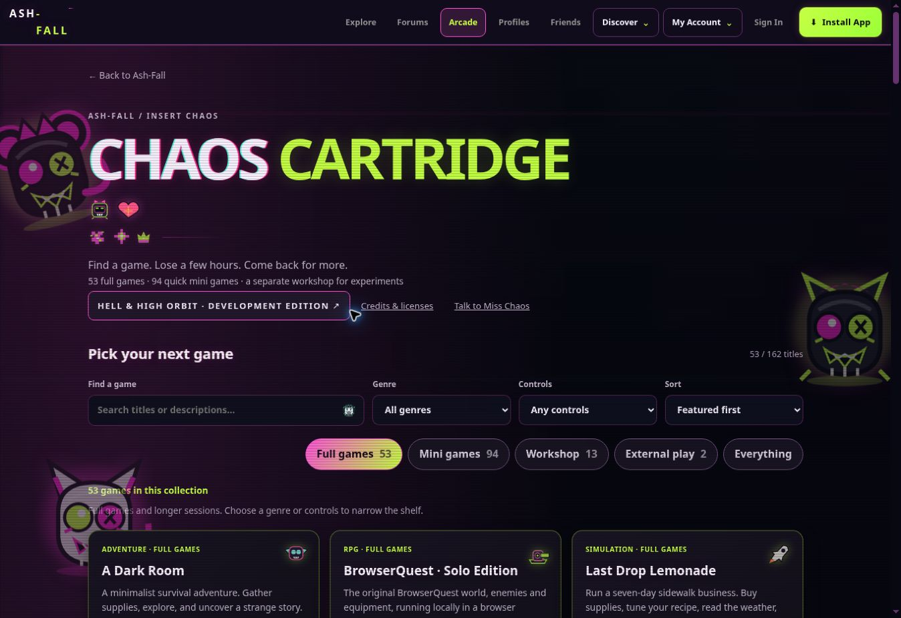

# Arcade audit — 30 October 2026

The two arcade directories now render from `public/arcade/catalog.json`. There are 162 unique listings: 53 full-game entries, 94 mini games, 13 workshop/prototype entries and two external titles. Collections describe format and development status, not a certification of overall game quality.

## Repairs

- Removed 26 misleading or duplicate shared-engine listings from the directory. A Dark Room and BrowserQuest now launch the real locally hosted editions. Other substitutes give way to separately named original cabinets; existing direct prototype URLs remain intact.
- Registered 59 missing game identities in the backend (58 found from catalog pages, plus the original Slush Rush bridge). Added 71 missing explicit score caps. Existing authentication and submission rules remain in force. Signed-in score persistence needs production verification after the API deployment.
- Fixed Ash Circuit's implicit `window.status` reference, which crashed initialization.
- Fixed Cinder Dice's missing board node and incorrect roll/bank function calls. CPU timers now cancel and invalidate after restarting.
- Fixed After Dark's empty snake rendering crash, restoring initialization for the later cabinets on that page; corrected arrow-key mapping and full-board termination.
- Fixed Graveyard Shift's undeclared pause state and missing pause button. Those failures previously prevented Cursed Circuit and Dumpster Dive from initializing.
- Fixed the zombie shooter's undeclared reduced-effects setting.
- Made Marshland Marksman's initial best-score load tolerate unavailable browser storage.
- Applied shared neon presentation, keyboard focus styling, touch-sized controls and fullscreen access to 104 first-party cabinets. Board artwork and game rules are preserved.
- Catalog filters cover genre, controls, collections and sorting. Search crosses collections. Both pages remain populated and playable without JavaScript. Floating character launchers no longer cover catalog launch buttons; Miss Chaos remains linked.

## Verification

- Visited all 160 local catalog routes in the browser and exercised available start controls. This was a launch audit, not full playthroughs, completed campaigns or multiplayer certification. Some mouse automation attempts timed out; keyboard activation and targeted retests were used to distinguish automation trouble from runtime failures.
- Retested Dice roll/bank, Ash Circuit initialization, Graveyard Shift start/pause, Cursed Circuit and Dumpster Dive initialization, After Dark initialization, and the zombie shooter start after repairs.
- 158 arcade/import regression tests pass, including new strict-DOM boot tests, Dice turn/restart behavior, pause behavior, generated-catalog consistency and backend score-registration coverage. Three additional security/score revision tests pass.
- Original asset manifest: 104 games and 142 sprites validated. Import audit: 162 entries; external titles explicitly labeled. Gameplay doctor reports no remaining known regression signatures.
- Verified directory filters and the real A Dark Room launch target in the browser. No horizontal overflow in the available desktop viewport. Existing CI fleet covers phone/tablet/desktop profiles.

## Limits and outstanding findings

- This browser disables WebGL. Pikkuautot, Sanctuary and GTA workshop gameplay cannot be certified here; their local build routes exist. A compatible Android/desktop graphics environment must verify these games and the 3D mission game.
- Account/cloud saves, downloads, installability, real multiplayer and production API rollout are separate checks. No authenticated session was used during local browser QA.
- The repository-wide static audit currently reports 135 failures beyond this catalog audit, including document fragments treated as standalone pages, dynamic sprite strings treated as literal URLs, existing profile checks, admin offline routes and game API references. The Slush Rush registration failure among them is repaired in this change. The global suite is not represented as green.
- The asset doctor reports 34 Interstellar Armada template-relative image references. Templates are injected relative to the game's document; their assets exist under the game root. These static findings alone do not establish missing runtime assets.
- Lightweight cabinets and older prototypes have not all received new artwork, deeper gameplay or complete progression redesigns. Workshop and mini-game separation makes that distinction visible.

Regenerate directories with `node scripts/build-arcade-catalog.mjs`. Validate with `node --test scripts/arcade-*.test.mjs scripts/selected-open-source-games.test.mjs`, `node scripts/arcade-originals-audit.mjs`, and `node scripts/arcade-import-audit.mjs`.

## Second pass

- Fixed stale CPU/round/sector callbacks in Connect Four, Ember Echo, Void Sequence and Ash Veil. Restarting or restoring a save invalidates the old work.
- Added native versioned snapshot export/import for the 15 games using the six replacement engines. Snapshots are checked for game/engine/schema identity, shape, finite values and size before application. Incompatible old-edition saves are rejected rather than interpreted using the wrong rules.
- Fixed first-frame restart callbacks in vector, action and driving engines so a rapid restart cannot create a second animation loop.
- Added 19 behavioral regression tests; the arcade/import total is now 177 passing tests.
- Corrected browser QA to crawl playable catalog entries and their runtime asset requests, rather than opening imported HTML fragments as standalone games. Updated old-edition save fixtures to native roundtrip tests. Test API stubs remain deterministic when a rewritten cabinet also loads arcade-save.js.
- Browser retests of the four restart repairs and representative vector/balance/driving cabinets found no uncaught errors in the available environment.

## Publication state

The user approved pushing and deploying the fixes on 30 October 2026. The first implementation is published through the connected GitHub app in PR #189; its Cloudflare preview deployed successfully. Production rollout and final workflow results are tracked in that PR. Normal Git push cannot authenticate in this workspace, so the connected GitHub app publishes the exact validated file tree instead.

The authorization/ownership workflows cannot complete their authenticated checks because dedicated test-account secrets are absent. Their gates are retained. The repository-wide static audit has the existing findings described above; it is not claimed green.
